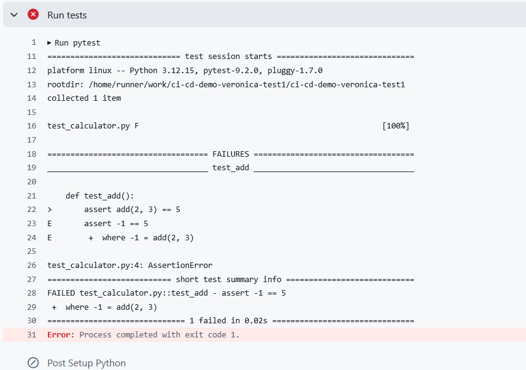
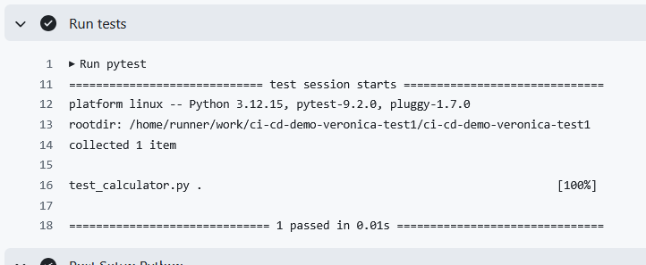
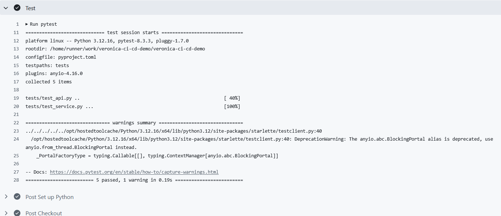

# Dokumentation av min kurs CI/CD

I denna filen dokumentearr jag alla övningar som görs under kursen. Detta för att jag ska kunna gå tillbaka och repetera allt vi gör.
Repot ligger i `Github` och jag pushar efter varje lektion/övning är slutförd.

Repot i sig `https://github.com/vickebjorklund-hue/ci-cd-demo-veronica-test1` är mitt test repo som jag arbetar i och sparar för övningarnas skull.

Vi har övningsuppgifter under lektionerna som benämns `Övning under lektion` och vi har uppgifter som ska lämnas in som benämns `Inlämningsuppgift - dag x`.
Jag kommer även spara våra fördjupningsövningar och självstudier i sparata Markdown som heter `STUDIER_X.md` i detta repo.

Alla inlämningsuppgifter pushas till `https://github.com/vickebjorklund-hue/xxxxxxxxxxxx` som är min kopia av huvudrepot: `https://github.com/cloudfactoreu/devops25-ci-cd-course`
och mitt lokala repo `https://github.com/vickebjorklund-hue/veronica-ci-cd-demo1` som är en fork på huvudrepot.

---

## Inlämningsuppgift - dag 1

Jag skapade en branch från main, gjorde en dokumentationsändring i README, commitade ändringen lokalt, pushade branchen till GitHub och skapade en Pull Request mot main. Jag mergeade inte eftersom övningen handlade om Git-flödet och Pull Request-processen.

---

## Övning under lektion - dag 2

introducerar en bug i ett litet projekt, för att kunna följ `git action` och avläsa informationen.

### Hur jag gjorde

Jag skapade ett eget repository (som kommer bli mitt test repo under hela kursen), konfigurerade en GitHub Actions-pipeline som automatiskt kör pytest vid varje push. Därefter introducerade jag medvetet ett fel i applikationen, observerade att teststeget misslyckades och analyserade loggarna för att spåra felet tillbaka till källkoden. Efter korrigering verifierade jag att pipelinen åter gick igenom. Detta visar hur CI automatiskt kvalitetssäkrar kod innan den kan levereras vidare.





---

## Inlämningsuppgift - dag 2

Beskrivning av vad jag gjorde.
En push till branchen startade inte CI-jobbet. Workflowen var konfigurerad att reagera på en Pull Request mot main. När PR:n skapades triggades workflowen, men GitHub krävde godkännande eftersom ändringen kom från en fork.



## Dag 2

### Syfte

Att förstå hur en CI-pipeline fungerar och hur GitHub Actions automatiserar tester och kvalitetskontroller.

---

### Hur CI startas

Workflowen kan triggas av:

```yaml
on:
  push:
  pull_request:
```

I vår övning startades CI när en Pull Request skapades mot `main`.

---

### Läsning av loggar

Vid ett fel:

```text
Actions
↓
Välj körning
↓
Öppna det röda steget
```

Läs alltid den faktiska felloggen, inte bara att pipeline-status är röd.

---

## Ruff och Pytest

### Ruff

- Statisk kodanalys
- Läser koden utan att köra den
- Hittar stilfel och vissa programmeringsfel

### Pytest

- Kör testfall
- Verifierar att programmet fungerar korrekt
- Hittar logiska fel

| Ruff | Pytest |
| -------- | -------- |
| Läser kod | Kör kod |
| Kodkvalitet | Funktionalitet |
| Statisk analys | Testkörning |

---

## GitHub-hosted vs Self-hosted Runner

### GitHub-hosted

- GitHub ansvarar för miljön
- Ingen installation krävs
- Passar de flesta projekt

### Self-hosted

- Organisationen ansvarar för servern
- Kräver underhåll och säkerhetshantering
- Kan användas för interna system eller särskild hårdvara

---

## När används Self-hosted Runners?

Exempel:

- Interna API:er
- Företagsnätverk
- Databaser bakom brandvägg
- GPU eller specialutrustning
- Särskilda säkerhetskrav

---

## Kunskapsmål efter dag 2

Jag ska kunna:

- Beskriva kedjan **Händelse → Workflow → Jobb → Runner → Steg → Resultat**
- Hitta och tolka en fellogg i GitHub Actions
- Förklara skillnaden mellan Ruff och Pytest
- Förstå hur en Pull Request triggar CI
- Resonera kring när GitHub-hosted respektive Self-hosted runners används
- Förklara varför snabb återkoppling är viktig i Continuous Integration

## Kort sammanfattning

CI automatiserar tester och kvalitetskontroller varje gång kod integreras i projektet. GitHub Actions använder workflows som körs på runners och består av olika jobb och steg. Genom verktyg som Ruff och Pytest kan fel upptäckas tidigt, vilket ger snabb återkoppling, högre kvalitet och säkrare leveranser.

---

## Dag 3 – Automatiserade tester, kodkvalitet och Quality Gates

### Syfte - dag 3

Målet med övningen var att förstå hur tester och kodkontroller används för att upptäcka fel innan kod når huvudbranchen samt hur CI-pipelines fungerar tillsammans med Pull Requests.

---

### Vad som gjordes

#### 1. Köra tester lokalt

Projektet verifierades med:

```bash
python -m pytest -v
```

samt kodgranskning med:

```bash
ruff check app tests
```

Pytest kontrollerade att funktionerna fungerade korrekt medan Ruff kontrollerade kodkvaliteten.

---

#### 2. Skapa ett avsiktligt fel

I testfilen `tests/test_service.py` ändrades:

```python
assert add(2, 3) == 5
```

till:

```python
assert add(2, 3) == 6
```

Syftet var att skapa ett kontrollerat testfel.

Resultatet blev:

```text
1 failed, 4 passed
```

---

#### 3. Skapa en röd pipeline

Ändringen committades och pushades till en separat demonstrationsbranch.

När GitHub Actions körde CI-pipelinen misslyckades teststeget eftersom testet förväntade sig värdet `6` medan funktionen faktiskt returnerade `5`.

I loggen kunde felet identifieras genom raden:

```text
assert 5 == 6
```

---

### Vad felet visade

Den röda CI-körningen visade att:

- testerna fungerar som en kvalitetssäkring
- fel upptäcks automatiskt
- kod med felaktiga testresultat stoppas innan merge

En röd pipeline betyder att något måste undersökas, men inte automatiskt att applikationen är trasig.

---

### Hur felet rättades

Testet ändrades tillbaka till:

```python
assert add(2, 3) == 5
```

Därefter verifierades:

```bash
python -m pytest -q
ruff check app tests
```

När alla tester passerade committades och pushades rättningen.

GitHub Actions körde då en ny pipeline som blev grön.

---

### Quality Gates

Övningen demonstrerade hur automatiska kontroller fungerar som en **Quality Gate**.

Exempel på Quality Gates:

- Godkända tester (Pytest)
- Godkänd kodkvalitet (Ruff)
- Pull Request
- Kodgranskning (Code Review)

Dessa kontroller hjälper till att förhindra att felaktig kod hamnar i `main`.

---

### Viktiga lärdomar

- Pytest testar funktionalitet.
- Ruff analyserar kodkvalitet.
- Tester bör köras både lokalt och i CI.
- En röd pipeline ska analyseras genom att läsa loggarna.
- Pull Requests kan kopplas till automatiska kontroller.
- Quality Gates hjälper team att hålla hög kvalitet innan merge.

---

# Dag 3 – Automatiserade tester, kodkvalitet och Quality Gates

## Syfte

Målet med övningen var att förstå hur tester och kodkontroller används för att upptäcka fel innan kod når huvudbranchen samt hur CI-pipelines fungerar tillsammans med Pull Requests.

---

## Vad som gjordes

### 1. Köra tester lokalt

Projektet verifierades med:

```bash
python -m pytest -v
```

samt kodgranskning med:

```bash
ruff check app tests
```

Pytest kontrollerade att funktionerna fungerade korrekt medan Ruff kontrollerade kodkvaliteten.

---

### 2. Skapa ett avsiktligt fel

I testfilen `tests/test_service.py` ändrades:

```python
assert add(2, 3) == 5
```

till:

```python
assert add(2, 3) == 6
```

Syftet var att skapa ett kontrollerat testfel.

Resultatet blev:

```text
1 failed, 4 passed
```

---

### 3. Skapa en röd pipeline

Ändringen committades och pushades till en separat demonstrationsbranch.

När GitHub Actions körde CI-pipelinen misslyckades teststeget eftersom testet förväntade sig värdet `6` medan funktionen faktiskt returnerade `5`.

I loggen kunde felet identifieras genom raden:

```text
assert 5 == 6
```

---

## Vad felet visade

Den röda CI-körningen visade att:

- testerna fungerar som en kvalitetssäkring
- fel upptäcks automatiskt
- kod med felaktiga testresultat stoppas innan merge

En röd pipeline betyder att något måste undersökas, men inte automatiskt att applikationen är trasig.

---

## Hur felet rättades

Testet ändrades tillbaka till:

```python
assert add(2, 3) == 5
```

Därefter verifierades:

```bash
python -m pytest -q
ruff check app tests
```

När alla tester passerade committades och pushades rättningen.

GitHub Actions körde då en ny pipeline som blev grön.

---

## Quality Gates

Övningen demonstrerade hur automatiska kontroller fungerar som en **Quality Gate**.

Exempel på Quality Gates:

- Godkända tester (Pytest)
- Godkänd kodkvalitet (Ruff)
- Pull Request
- Kodgranskning (Code Review)

Dessa kontroller hjälper till att förhindra att felaktig kod hamnar i `main`.

---

## Viktiga lärdomar - dag 3

- Pytest testar funktionalitet.
- Ruff analyserar kodkvalitet.
- Tester bör köras både lokalt och i CI.
- En röd pipeline ska analyseras genom att läsa loggarna.
- Pull Requests kan kopplas till automatiska kontroller.
- Quality Gates hjälper team att hålla hög kvalitet innan merge.
