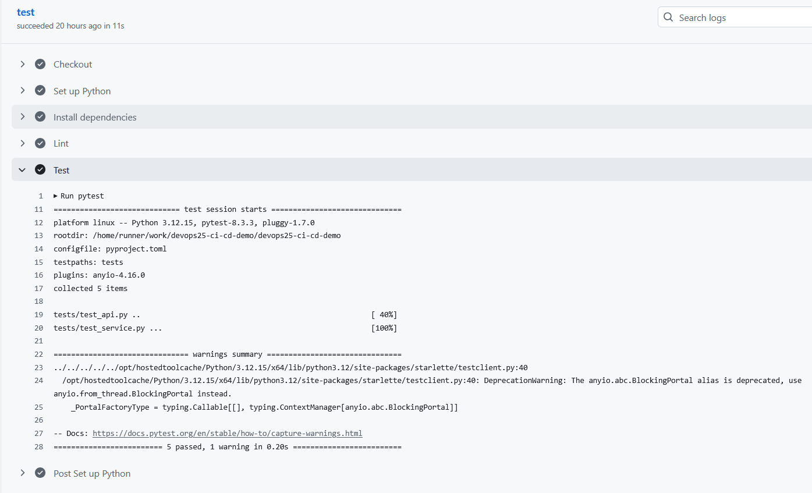

# ci-cd-demo-veronica-test1

## En enkel lektions övning

introducerar en bug i ett litet projekt, för att kunna följ `git action` och avläsa informationen.

## Hur jag gjorde

Jag skapade ett eget repository, konfigurerade en GitHub Actions-pipeline som automatiskt kör pytest vid varje push. Därefter introducerade jag medvetet ett fel i applikationen, observerade att teststeget misslyckades och analyserade loggarna för att spåra felet tillbaka till källkoden. Efter korrigering verifierade jag att pipelinen åter gick igenom. Detta visar hur CI automatiskt kvalitetssäkrar kod innan den kan levereras vidare.

## Övning dag 1

Beskrivning av vad jag gjorde.
Jag skapade en branch från main, gjorde en dokumentationsändring i README, commitade ändringen lokalt, pushade branchen till GitHub och skapade en Pull Request mot main. Jag mergeade inte eftersom övningen handlade om Git-flödet och Pull Request-processen.

## Övning dag 2

Beskrivning av vad jag gjorde.
En push till branchen startade inte CI-jobbet. Workflowen var konfigurerad att reagera på en Pull Request mot main. När PR:n skapades triggades workflowen, men GitHub krävde godkännande eftersom ändringen kom från en fork.

